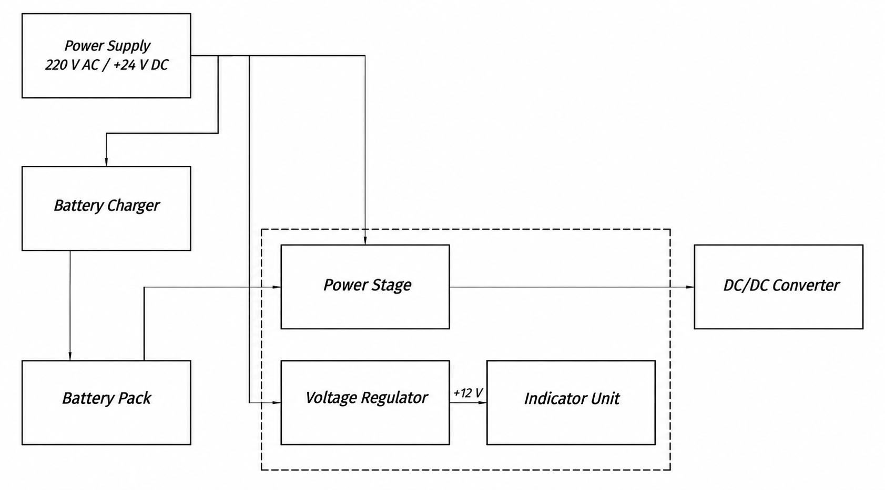
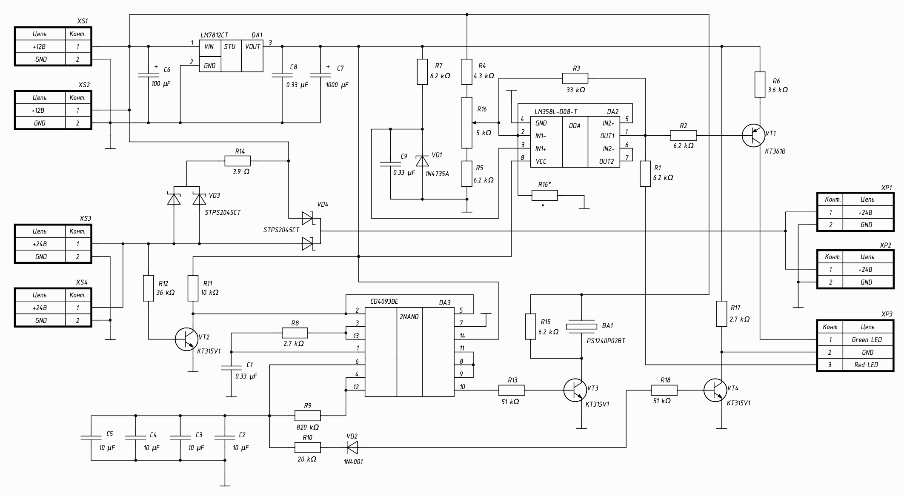
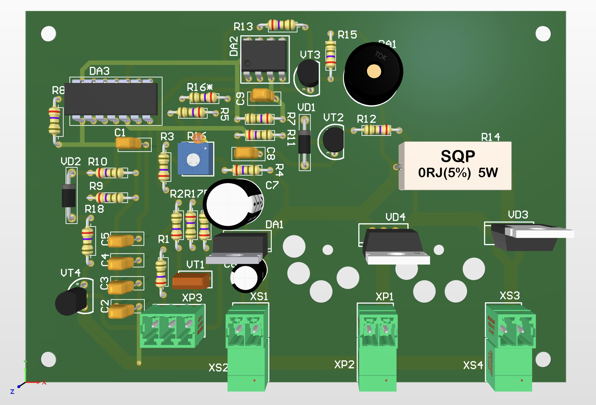
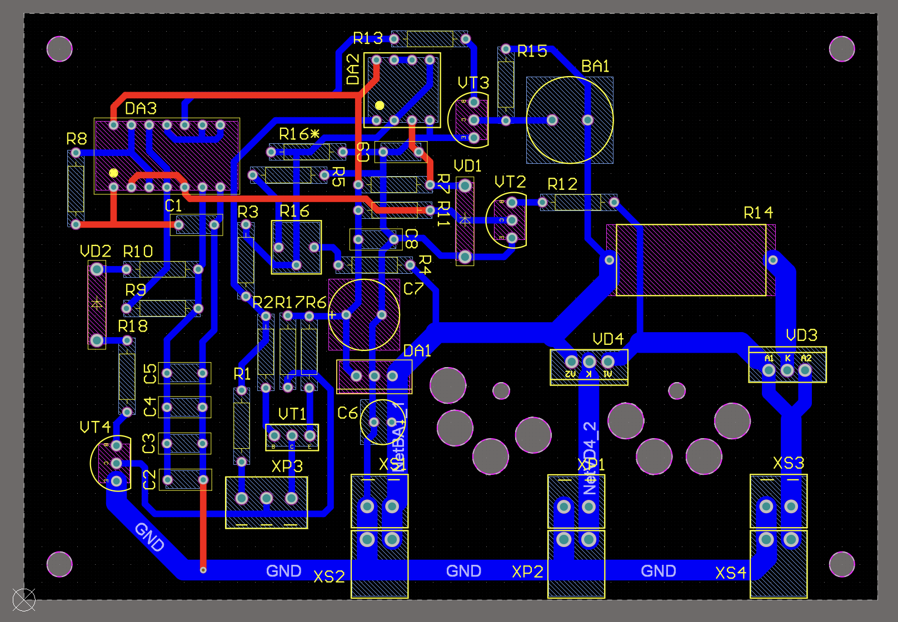
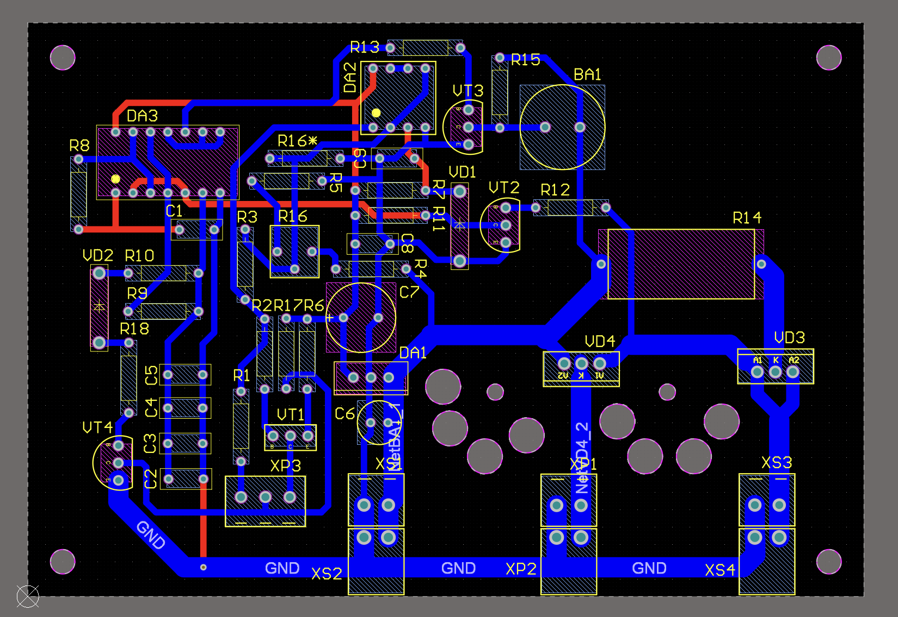
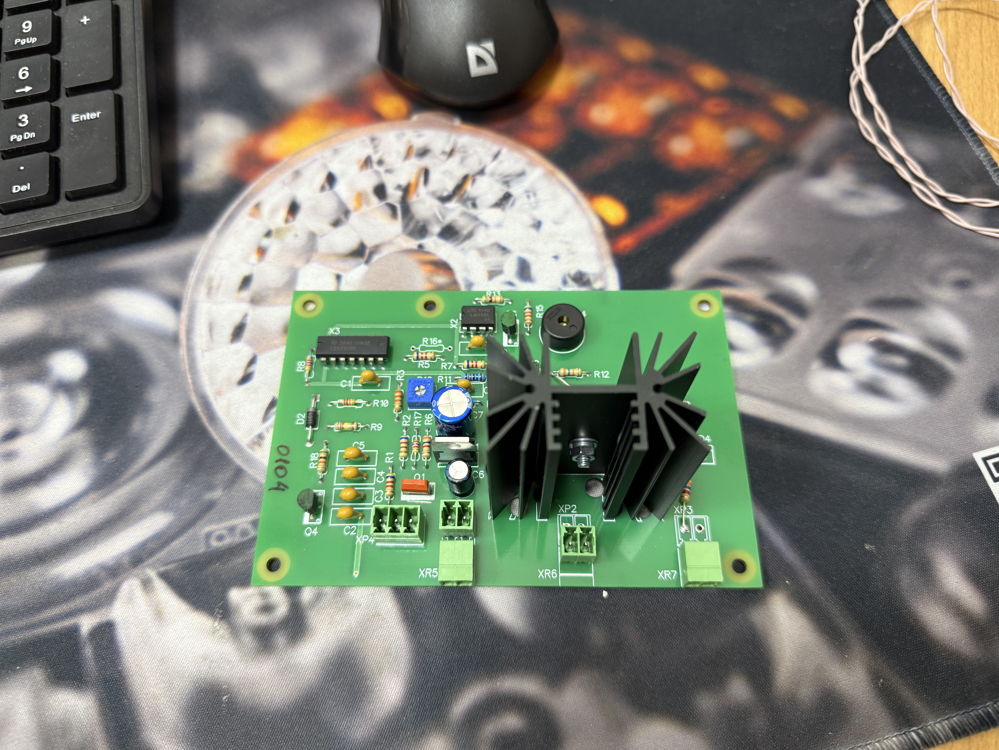

# Auto PSU

An automatic power-source selection board with **24 V DC main power** and a **nominal 12 V battery backup**. When the main supply is lost, the diode-based power path transfers the load to the battery without an intentional switching delay. Battery operation activates an audible alert and changes the external indicator from steady illumination to blinking.

The indicator changes from **green** at full charge, through **yellow**, to **red** at a critically low battery level.

The repository contains the Altium Designer project, PCB views, fabrication files, BOM, and original Russian engineering documentation.

## My Contribution

This project is based on a board design created before my involvement. I transferred the existing design to **Altium Designer** and prepared the schematic, PCB layout, component libraries, bill of materials, and engineering documentation.

My work included component selection, standardizing schematic symbols and footprints, clarifying component parameters, and aligning the schematic, PCB, and documentation. I also **personally assembled and soldered the board**.

## Block Diagram

An external AC/DC supply provides the main 24 V input. An external charger and battery pack provide backup energy. The board selects the available source and supplies a downstream DC/DC converter. Its monitoring circuitry drives the visual indicator and audible alert.

The AC/DC supply, battery charger, battery pack, and downstream DC/DC converter are external to this PCB.

## Schematic

The STPS2045CT Schottky rectifiers form the power-routing network. VD4 combines the main and battery supply paths at the output; VD3 and R14 form an additional path between the main-supply and battery nodes.

The LM7812CT regulator (DA1) supplies the monitoring circuitry. The LM358L-D08-T (DA2), 6.2 V Zener reference VD1, and resistor network monitor battery voltage. Potentiometer R16 provides an adjustment point. The CD4093BE (DA3), RC networks, and transistor stages control blinking and the piezoelectric sounder BA1. The external red/green indicator connects to XP3.

### Operating Modes

| Condition | Output source | Visual indication | Audible indication |
| --- | --- | --- | --- |
| 24 V main supply present | Main supply | Steady; colour reflects battery level | Inactive |
| Main supply absent | Nominal 12 V battery supply | Blinking; colour reflects battery level | Active |

The output is not a regulated 24 V rail in backup mode: it follows the battery voltage minus the power-path diode drop. The downstream converter must accommodate both supply conditions. No measured transfer time is specified.

## PCB

### 3D View

### Top Layer

### Bottom Layer

The PCB uses **two copper layers** and through-hole components mounted on one side. The layout includes the power rectifiers, a 5 W resistor, monitoring circuitry, an adjustment potentiometer, a piezoelectric sounder, and pluggable connectors.

## Assembled Board

The photograph shows the assembled board, including the power-stage heatsink, monitoring circuitry, adjustment potentiometer, and onboard sounder.

### Hardware and Documentation Versions

The photographs show hardware that I assembled and soldered. Some photographed boards are earlier versions and may differ from the published Altium files in component placement, markings, or implementation details. The Altium files and engineering documents describe the version prepared during my work on the project.

## Bill of Materials

| Designators | Qty | Value / Part | Description | Manufacturer | Part Number | Package |
| --- | ---: | --- | --- | --- | --- | --- |
| BA1 | 1 | PS1240P02BT | Piezoelectric sounder | TDK | PS1240P02BT | THT |
| C1, C8, C9 | 3 | 0.33 µF | Capacitor, 50 V, 10% | Murata | RDER71H334K1K1C03B | THT |
| C2, C3, C4, C5 | 4 | 10 µF | Capacitor, 50 V, 10% | JB Capacitors | JYM1H106MBF010000B | THT |
| C6 | 1 | 100 µF | Capacitor, 35 V, 20% | JB Capacitors | JRB1V101M02500630120000B | THT |
| C7 | 1 | 1000 µF | Capacitor, 16 V, 20% | JB Capacitors | JRB1C102M05001000170000B | THT |
| DA1 | 1 | LM7812CT | Linear voltage regulator, 12 V | Inchange Semiconductor | LM7812CT | TO-220 |
| DA2 | 1 | LM358L-D08-T | Dual operational amplifier | Unisonic Technologies | LM358L-D08-T | DIP-8 |
| DA3 | 1 | CD4093BE | Quad two-input Schmitt-trigger NAND gate | Texas Instruments | CD4093BE | DIP-14 |
| R1, R2, R5, R7, R15 | 5 | 6.2 kΩ | Carbon-film resistor, 0.25 W, 5% | Yageo | CF-1/4W-6K2J | CF-25 |
| R3 | 1 | 33 kΩ | Carbon-film resistor, 0.25 W, 5% | Yageo | CF-1/4W-33KJ | CF-25 |
| R4 | 1 | 4.3 kΩ | Carbon-film resistor, 0.25 W, 5% | Yageo | CF-1/4W-4K3J | CF-25 |
| R6 | 1 | 3.6 kΩ | Carbon-film resistor, 0.25 W, 5% | Yageo | CF-1/4W-3K6J | CF-25 |
| R8, R17 | 2 | 2.7 kΩ | Carbon-film resistor, 0.25 W, 5% | Yageo | CF-1/4W-2K7J | CF-25 |
| R9 | 1 | 820 kΩ | Carbon-film resistor, 0.25 W, 5% | Yageo | CF-1/4W-820KJ | CF-25 |
| R10 | 1 | 20 kΩ | Carbon-film resistor, 0.25 W, 5% | Yageo | CF-1/4W-20KJ | CF-25 |
| R11 | 1 | 10 kΩ | Carbon-film resistor, 0.25 W, 5% | Yageo | CF-1/4W-10KJ | CF-25 |
| R12 | 1 | 36 kΩ | Carbon-film resistor, 0.25 W, 5% | Yageo | CF-1/4W-36KJ | CF-25 |
| R13, R18 | 2 | 51 kΩ | Carbon-film resistor, 0.25 W, 5% | Yageo | CF-1/4W-51KJ | CF-25 |
| R14 | 1 | 3.9 Ω | Wirewound resistor, 5 W, 5% | Yageo | SQP-5W-3R9J | THT |
| R16 | 1 | 5 kΩ | Potentiometer | Bourns | 3362P-1-502LF | THT |
| R16* | 1 | Not specified | Fixed resistor | Yageo | — | CF-25 |
| VD1 | 1 | 1N4735A | Zener diode, 6.2 V | Semtech Electronics | 1N4735A | DO-41 |
| VD2 | 1 | 1N4001 | Rectifier diode, 1 A, 50 V | Diotec Semiconductors | 1N4001 | DO-41 |
| VD3, VD4 | 2 | STPS2045CT | Dual Schottky rectifier, 2 x 10 A, 45 V | ST Microelectronics | STPS2045CT | TO-220AB |
| VT1 | 1 | KT361B | PNP bipolar transistor | GOST | KT361B | KT-13 |
| VT2, VT3, VT4 | 3 | KT315V1 | NPN bipolar transistor | GOST | KT315V1 | TO-92 |
| XP1 | 1 | 15EDGVC-3.5-02 | 2-pin connector (plug) | Degson Electronics | 15EDGVC-3.5-02 | THT |
| XP2 | 1 | 15EDGRC-3.5-02 | 2-pin connector (plug) | Degson Electronics | 15EDGRC-3.5-02 | THT |
| XP3 | 1 | 15EDGVC-3.5-03P-14-00AH | 3-pin connector (plug) | Degson Electronics | 15EDGVC-3.5-03P-14-00AH | THT |
| XS1, XS3 | 2 | 15EDGVC-3.5-02 | 2-pin connector (socket) | Degson Electronics | 15EDGVC-3.5-02 | THT |
| XS2, XS4 | 2 | 15EDGRC-3.5-02 | 2-pin connector (socket) | Degson Electronics | 15EDGRC-3.5-02 | THT |

[CSV BOM](docs/auto-psu.csv) · [Altium BOM document](hardware/altium/auto-psu.BomDoc)

## Additional Notes

- This board uses analog monitoring and logic circuitry without a microcontroller.
- R16* has no value or part number in the supplied BOM. Its selection remains to be documented.
- Manufacturer entries are reproduced from the CSV, including “GOST” for VT1–VT4; these entries do not identify a specific semiconductor manufacturer.
- Battery chemistry, indication thresholds, rated load current, and measured transfer time are not specified in the supplied material.

## Documentation (Russian)

- [E1 — Block diagram](docs/original-ru/auto-psu_E1_block-diagram.pdf)
- [E3 — Schematic](docs/original-ru/auto-psu_E3_schematic.PDF)
- [PE3 — Parts list](docs/original-ru/auto-psu_PE3_part-list.pdf)
- [PP — PCB drawing](docs/original-ru/auto-psu_PP_board-drawing.PDF)
- [SB — Assembly drawing](docs/original-ru/auto-psu_SB_assembly-drawing.pdf)
- [SP — Product specification](docs/original-ru/auto-psu_SP_specification.pdf)

## Fabrication Files

[Gerber archive](fabrication/auto-psu_gerber.zip) · [STEP model](fabrication/auto-psu.step) · [Altium project](hardware/altium/auto-psu.PrjPcb)
